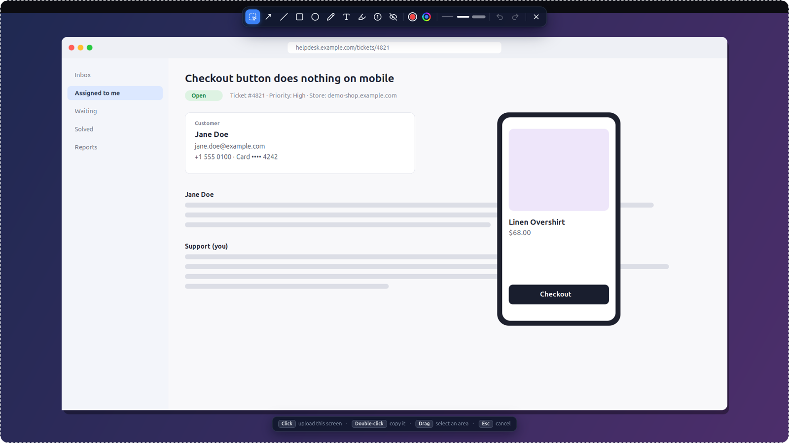
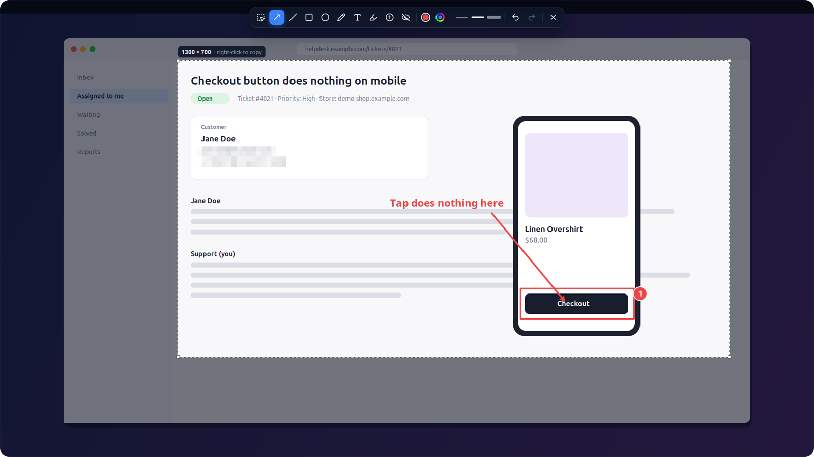
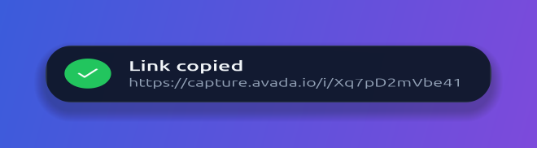
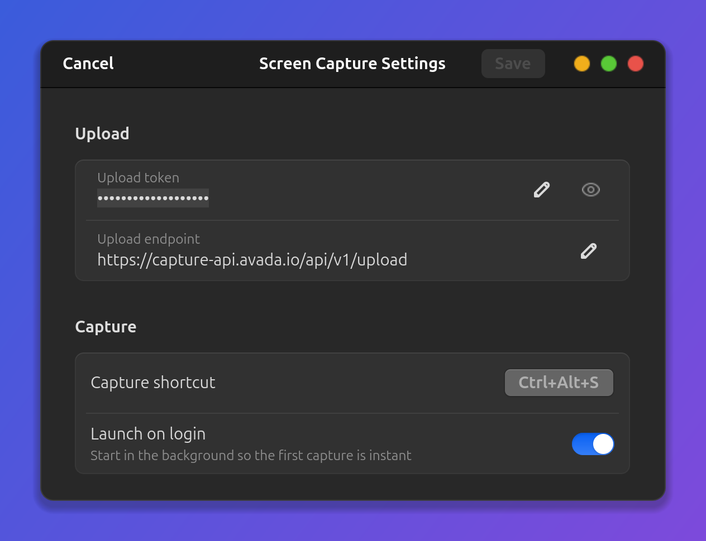

# Screen Capture

Công cụ chụp màn hình kiểu ShareX cho GNOME trên **Wayland** (Ubuntu 26.04 / GNOME 50). Bấm một phím tắt, màn hình đóng băng trên mọi monitor; click để chụp monitor dưới chuột, kéo để chọn vùng, vẽ chú thích nếu cần. Ảnh được upload lên capture.avada.io và link được copy vào clipboard, không có hộp thoại xác nhận nào.



## Cài đặt

Yêu cầu (đều là package hệ thống của Ubuntu):

```bash
sudo apt install python3-gi python3-gi-cairo gir1.2-gtk-4.0 gir1.2-gstreamer-1.0 gstreamer1.0-pipewire python3-requests
```

Rồi trong thư mục project:

```bash
scripts/install.sh              # phím tắt Print, D-Bus service, entry trong app grid
scripts/install.sh --autostart  # như trên, và chạy nền sẵn khi đăng nhập
```

Script cài đặt có thể chạy lại nhiều lần mà không tạo thêm phím tắt. Nó chỉ thêm và cập nhật phím tắt của chính mình. Ngoại lệ duy nhất: khi phím của app là `Print`, nó gỡ `Print` khỏi giao diện chụp màn hình có sẵn của GNOME để hai bên không tranh nhau (`Shift+Print` / `Alt+Print` của GNOME vẫn giữ nguyên). App chạy trực tiếp từ thư mục này, nên nếu di chuyển thư mục thì chạy lại `install.sh`.

### Token upload

Cách dễ nhất: mở **Cài đặt** (từ icon trên thanh trên, hoặc chuột phải vào app trong app grid) và dán token vào.

Token **không** nằm trong repo. App tìm token theo thứ tự:

1. `token` trong `~/.config/screen-capture/config.ini`:
   ```ini
   [General]
   token = <token của bạn>
   # tuỳ chọn:
   # upload_url = https://capture-api.avada.io/api/v1/upload
   # save_dir = ~/Pictures/screen-capture-failed
   ```
2. `customUploadToken` trong `~/.config/flameshot/flameshot.ini` (nếu đã dùng bản Flameshot của Avada).

## Cách dùng

`Print` (đổi được trong Cài đặt) mở overlay trên tất cả monitor. Monitor dưới chuột có viền trắng đứt đoạn, các monitor còn lại bị làm tối.

| Thao tác | Kết quả |
|---|---|
| Click | Upload cả monitor đó, copy link |
| Double-click | Copy ảnh cả monitor vào clipboard, **không** upload |
| Kéo chuột trái | Chọn vùng; thả ra để upload và copy link |
| Đang kéo, bấm chuột phải | Copy vùng đang chọn vào clipboard, **không** upload |
| `Esc` | Huỷ |

Có thể vẽ trước rồi mới chọn vùng; chú thích sẽ nằm trong ảnh, toolbar thì không.



Upload xong, link nằm sẵn trong clipboard:

<p align="center"></p>

| Phím | Công cụ | Phím | Công cụ |
|---|---|---|---|
| `S` | Chọn / chụp (hoặc chuột phải) | `P` | Bút vẽ tự do |
| `A` | Mũi tên | `T` | Chữ (`Enter` để xong) |
| `L` | Đường thẳng | `H` | Bút dạ quang |
| `R` | Hình chữ nhật | `N` | Đánh số bước 1, 2, 3 |
| `C` | Hình tròn / elip | `B` | Làm mờ (che dữ liệu khách hàng) |

`Ctrl+Z` / `Ctrl+Shift+Z` để hoàn tác / làm lại. Trên toolbar có màu đỏ mặc định, nút cầu vồng để chọn màu RGB bất kỳ, và ba mức độ dày nét.

Upload lỗi (mất mạng, token sai…): ảnh được lưu vào `~/Pictures/screen-capture-failed/` và notification báo đường dẫn.

## Icon trên thanh trên và Cài đặt

Khi app chạy nền, icon của nó nằm trên thanh trên (cần extension AppIndicator, Ubuntu bật sẵn). Menu gồm:

- **Capture** — chụp (hiện kèm phím tắt đang dùng)
- **Recent links** — 5 link upload gần nhất trong phiên này, bấm để copy lại
- **Open failed uploads folder**
- **Settings…** — token, endpoint upload, phím tắt chụp, chạy khi đăng nhập. Chỉ áp dụng khi bấm **Save**; endpoint phải là `https://`, phím tắt phải có Ctrl/Alt/Super và không trùng phím tắt khác.
- **Quit** — tắt app nền (phím tắt sẽ tự bật lại app)

<p align="center"></p>

## Quản lý app

```bash
python3 -m screen_capture --autostart on|off|status   # bật/tắt chạy khi đăng nhập
python3 -m screen_capture --quit                      # tắt app đang chạy nền
python3 -m screen_capture --background                # chạy nền mà không mở overlay
python3 -m screen_capture --settings                  # mở cửa sổ Cài đặt
```

## Cách hoạt động

- Chụp màn hình qua `org.gnome.Mutter.ScreenCast` + PipeWire (khoảng 70–130 ms cho cả hai monitor, không có flash). Nếu không được thì dùng portal `org.freedesktop.portal.Screenshot` (khoảng 0.5 s, có flash).
- App chạy nền (resident) để mở overlay nhanh và để giữ nội dung clipboard: trên Wayland, clipboard do chính tiến trình đã copy cung cấp.
- Chi tiết thiết kế: `docs/superpowers/specs/`. Số liệu đo đạc: `docs/superpowers/notes/`.

## Phát triển

```bash
python3 -m unittest discover -s tests -v
```

Sau khi sửa code, chạy `python3 -m screen_capture --quit` để phím tắt khởi động lại app với code mới. Ghi chú cho Claude Code nằm trong `CLAUDE.md`.

Icon toolbar là [Lucide](https://lucide.dev) (ISC, xem `screen_capture/icons/LICENSE-lucide`).
